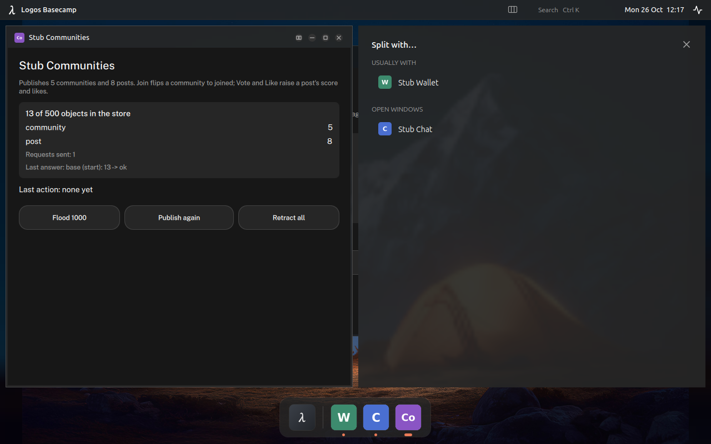
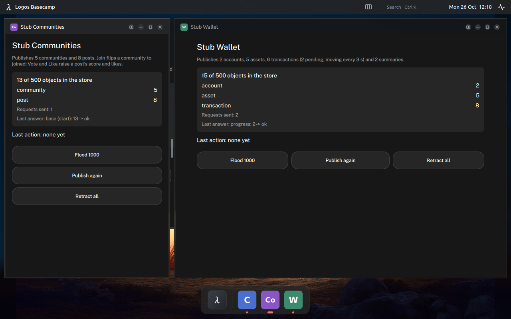
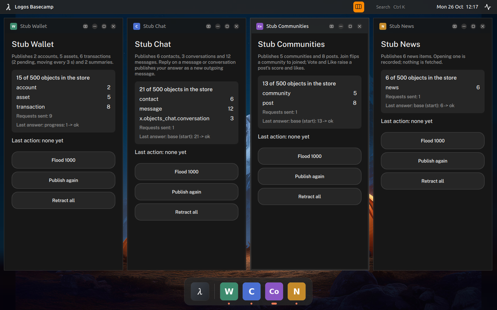
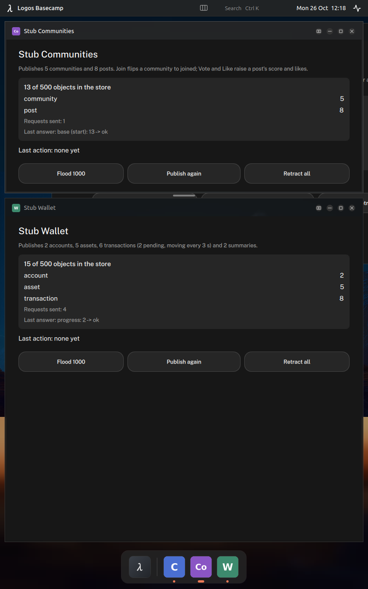

# Split view: spec

Status: ported, 2026-10-26, Basecamp source branch `keychain`. Desktop layout (Basecamp Legacy) only; Basecampium (tabs, the default shell) is unchanged. Decision: [ADR-084](adr/0084-split-view-in-desktop-layout.md). Contributed by Vaclav Pavlin ([vpavlin/basecampos](https://github.com/vpavlin/basecampos), branch `basecamp-shell`).

## TL;DR

- Every window's title bar has a fourth button, **Split**. The window takes the left half (top half on a portrait screen); the other half offers what to put next to it.
- The offer lists the window's **usual partners** first (pairs used before, launched if they are closed), then the other open windows. With exactly one other window and no history, that window joins at once.
- A **divider** between the halves resizes them, snapping to 1/3, 1/2 and 2/3. Double-click swaps the sides.
- Pairs and their ratio are remembered in one small JSON file, ranked by how often and how lately they were used.

## 1. Rules

| Event | Result |
|---|---|
| Split button | The window takes the first half; the picker fills the second. Tiling turns off. |
| Pick an open window | It takes the second half at the pair's remembered ratio (1/2 if new). |
| Pick a closed partner | The picker says "Opening ...", Basecamp launches the app, and the split completes when its window arrives. |
| An app opened from the dock, or a minimised window restored, while the picker waits | It takes the empty half. |
| An app opened while split | It replaces the side the user was working in. |
| Drag the divider | Ratio between 0.2 and 0.8, pulled onto 1/3, 1/2 or 2/3 within 0.025. The ratio is saved on release. |
| Double-click the divider | The sides swap; each window keeps its size. |
| Minimise or close one side | The split ends; the other window is maximised. |
| Maximise, double-click a title bar, or drag a window | The split ends. |
| Turn tiling on | The split ends. Starting a split turns tiling off. |
| Picker close button or Esc | The split ends. |
| Resize or rotate the screen | The split is laid out again; top/bottom whenever the free area is taller than wide. |

The split uses the same free area as a maximised window (below the status bar, above the dock), with 10 px gaps. The divider's hit area is the gap plus 12 px over each window's edge, and the title-bar buttons take the full bar height, so both work with a finger.

## 2. Storage

`<AppConfigLocation>/split-pairs.json` (on Linux, `$XDG_CONFIG_HOME/Logos/LogosBasecamp/split-pairs.json`): an array of
`{a, b, aTitle, bTitle, aIcon, bIcon, ratio, count, last}`, one entry per unordered pair. `ratio` is the share of `a`; seen from `b` it is `1 - ratio`. A new split adds 1 to `count`; a resize or swap only updates `ratio` and `last`.

Rank: `count x 0.5^(days since last / 7)`, so a pair's weight halves every week it is not used. The file keeps the 30 best pairs. A missing or unreadable file means no history.

## 3. Changes from the contribution

- The picker draws each app with the shell's app tile (rounded, letters when there is no icon file), as the title bars in this tree do.
- The snap moved into `DesktopArea::snapSplitRatio` and the rank takes an optional clock, so both can be unit-tested. Behaviour is unchanged.

## 4. Test results

Unit (`desktop_split_test`, offscreen, 18 cases, all pass; full suite 50 of 50): snapping and clamping, weekly halving, file round trip with rank and the cap of 30, corrupt file, partners seen from either side with the flipped ratio, landscape and portrait layout, dock reserve, divider drag (snaps to 1/3) and double-click swap with real mouse events, tiling and split excluding each other, the only other window joining at once, the picker filled by a dock launch, a restored window and a launched partner, opening while split, minimise, close and the maximise button leaving the split, the Split button.

Headless (private compositor, own profile, Basecamp Legacy, 1280x800 and 800x1280):

| Check | Result |
|---|---|
| Split button, picker, pick an open window | Pass.  |
| Remembered partners after a restart, closed partner launched, remembered ratio 1/3 | Pass.  |
| Dock launch while the picker waits fills the empty half | Pass |
| Maximise leaves the split | Pass |
| Tiling ends the split; Split while tiling turns tiling off | Pass.  |
| Portrait: top/bottom, picker below | Pass.  |
| Basecampium (default) | Unchanged: tabs, no Split button, no pairs file written |

Not checked headless: dragging the divider and double-clicking it (the headless seat has no pointer device and the inspector only clicks); both are covered by the unit test. The remembered 1/3 ratio above was set in the pairs file before the restart, standing in for a drag.

## 5. Open

- The window behind a split shows through the 10 px gap between the halves.
- Icon paths are stored absolute, so a moved profile shows letters until the pair is used again.
- A remembered partner whose app was uninstalled stays in the list until it ranks out; picking it should leave the picker at "Opening ..." (not tested).
- Real touch on the divider and the title-bar buttons needs a person at a touchscreen.
